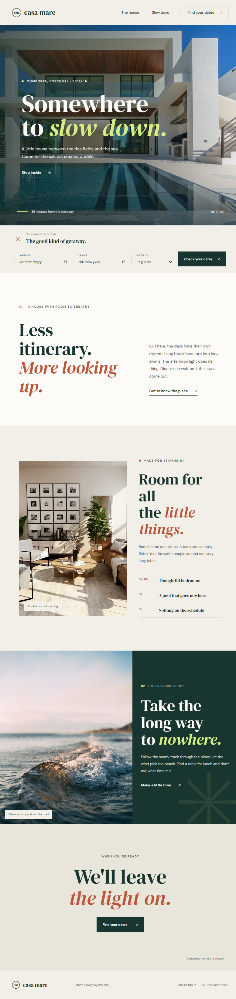

# Casa Mare

Casa Mare is a responsive landing page for a fictional coastal hideaway in Comporta, Portugal. The page pairs an editorial, photo-led layout with a small date-selection interaction. It is built with plain HTML, CSS, and JavaScript, with no build step or project dependencies.



## Contents

```text
.
├── index.html       Page structure and content
├── styles.css       Layout, visual styles, and responsive rules
├── script.js        Mobile navigation and booking form behavior
├── screenshot.png   Full-page page capture
└── README.md        Project notes and usage
```

## Run locally

Open `index.html` directly in a browser. No package installation or development server is required. The page can also be hosted as a static site; keep the HTML, CSS, JavaScript, and screenshot files together.

An internet connection is needed to load the photographs from Unsplash and the typefaces from Google Fonts. Without it, the page still works and falls back to system serif and sans-serif fonts.

## What’s included

- A responsive landing page with a full-bleed hero, stay details, neighborhood feature, and closing call to action.
- A booking form with arrival and departure dates and a guest selector for one to six guests.
- Date validation that prevents past arrival dates and requires departure to be after arrival.
- A confirmation message showing the selected dates and guest count.
- A compact mobile navigation with accessible expanded-state and menu labels.
- Reduced-motion support and descriptive alternative text for the photographs.

The booking form is a front-end demonstration only. It does not check real availability, submit data to a server, or make a reservation.

## Customize

- Edit headings, copy, links, and image URLs in `index.html`.
- Adjust the color palette and typography near the top of `styles.css` in the `:root` custom properties. Responsive layout rules are grouped into media queries near the bottom of the file.
- Update menu behavior, date validation, or the confirmation message in `script.js`.
- Replace the remote image URLs with your own optimized images if you adapt the page for a real property.